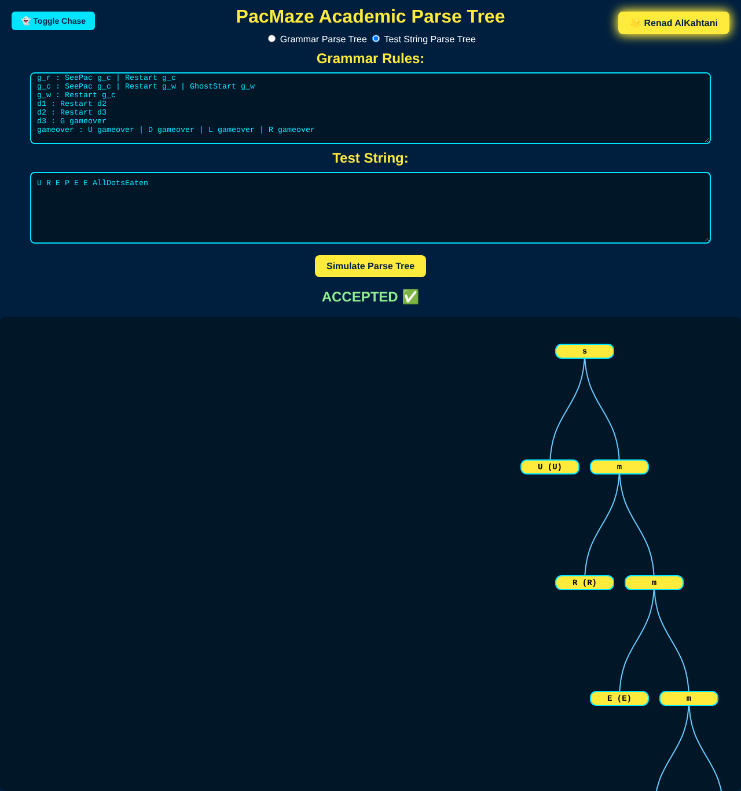
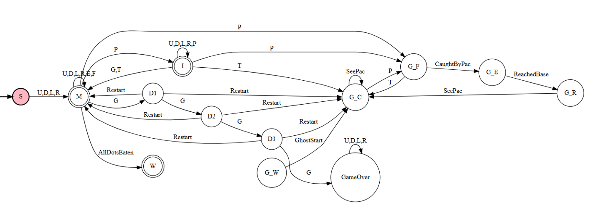
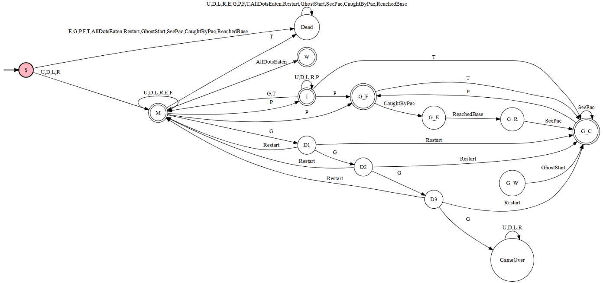
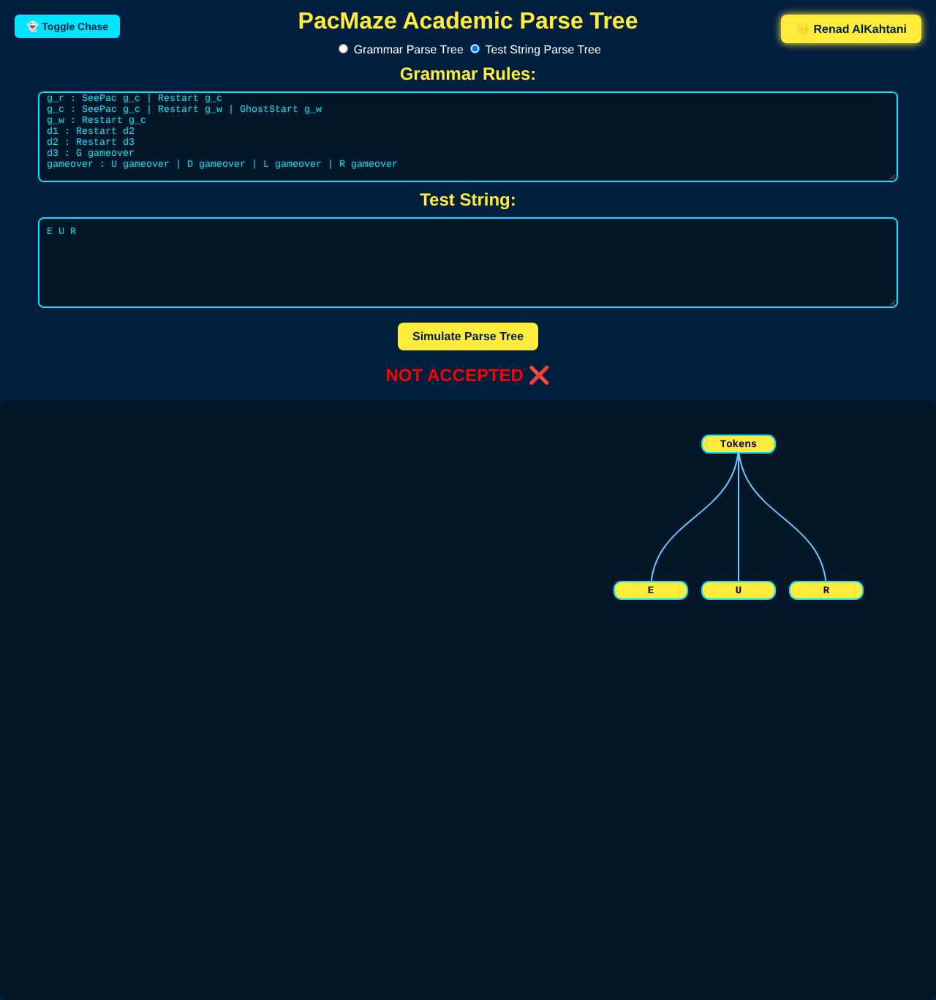

# 👾 PacMan Automaton: Language Theory & Finite Automata

Modeling the **Pac-Man** game as a formal language: from an **NFA** and **DFA**, to a **context-free grammar**, to a syntax analyzer built with **ANTLR**, and finally an interactive **PacMaze** website that draws the parse tree of any game sequence.

> Course project for **CS422: Language Theory & Finite Automata**, Imam Abdulrahman Bin Faisal University (IAU), 2024–2025.

<p align="center">
  
</p>

---

## 🎮 The language of Pac-Man

Every move and game event is a symbol, and every valid game is a string in the language.

**Alphabet (Σ)**

| Symbol | Meaning | Symbol | Meaning |
|---|---|---|---|
| `U` `D` `L` `R` | Move up / down / left / right | `AllDotsEaten` | All dots eaten (win) |
| `E` | Eat a dot | `Restart` | Start a new game |
| `G` | Meet a ghost (may lose a life) | `GhostStart` | A ghost starts moving |
| `P` | Eat a power pellet (invincible) | `SeePac` | A ghost sees Pac-Man and chases |
| `F` | Eat a fruit (bonus) | `CaughtByPac` | Invincible Pac-Man eats a ghost |
| `T` | Power-pellet timer expires | `ReachedBase` | An eaten ghost returns to base |

**States (Q):** `S` start · `M` moving · `I` invincible · `D1` `D2` `D3` lives lost · `GameOver` · `W` win · ghost states `G_W` waiting, `G_C` chasing, `G_F` fleeing, `G_E` eaten, `G_R` returning.

- ✅ `U E L E D R F`: moves up, eats a dot, moves left, eats another dot, moves down and right, then eats a fruit.
- ❌ `P G`: invalid, because the game can't start by eating a power pellet.

## 🧩 Project phases

### Phase 1: NFA
A non-deterministic finite automaton for Pac-Man and the ghosts, with its formal definition (Q, Σ, δ, q₀, F) and transition table.

<p align="center"></p>

### Phase 2: DFA & grammar
The NFA converted to a **DFA** (with a dead/trap state), string acceptance analysis, and production rules for both the NFA and the DFA grammar.

<p align="center"></p>

### Phase 3: Syntax analyzer & website
- The grammars were written in **ANTLR** ([`grammars/`](grammars)) and turned into a Java parser in IntelliJ, which accepts or rejects test strings and builds their parse trees.
- **PacMaze website** ([`pacmaze-web/`](pacmaze-web)): paste a grammar and a test string, and the site shows whether the string is **ACCEPTED ✅** or **NOT ACCEPTED ❌** and draws the parse tree with D3.js. It has two modes, grammar tree and test-string tree, plus a Pac-Man & ghost chase animation.

## ▶️ Try the website

1. Open [`pacmaze-web/index.html`](pacmaze-web/index.html) in a browser (it loads D3.js from the internet).
2. Paste the grammar from [`pacmaze-web/examples/pacman-grammar.txt`](pacmaze-web/examples/pacman-grammar.txt). Each rule goes on one line as `rule : option | option`, with `ε` for empty, and the first rule is the start symbol.
3. Choose **Test String Parse Tree**, enter a string with spaces between symbols, and press **Simulate Parse Tree**.

| Test string | Result |
|---|---|
| `U R E P E E AllDotsEaten` | ✅ Accepted |
| `L E T` | ✅ Accepted |
| `E U R` | ❌ Rejected (must start with a move) |
| `U R G` | ❌ Rejected |

<p align="center">
  
</p>

## 📁 Repository structure

```
.
├── docs/
│   ├── pacman-automaton-report.pdf   # Full report: phases 1–3 (NFA, DFA, grammars, ANTLR, website)
│   └── images/
├── grammars/
│   ├── PacManNFA.g4                  # ANTLR grammar for the NFA
│   └── PacManDFA.g4                  # ANTLR grammar for the DFA
├── pacmaze-web/
│   ├── index.html                    # Interactive parse-tree website
│   ├── pacman.png
│   └── examples/                     # Ready-to-paste grammar + test strings
└── README.md
```

## 🛠️ Tools

NFA/DFA design · Context-free grammars · **ANTLR 4** + IntelliJ (Java) · HTML/CSS/JavaScript · **D3.js**

---

<details>
<summary>🇸🇦 ملخص بالعربي</summary>

مشروع مادة **نظرية اللغات والأوتوماتا (CS422)**: مثّلنا لعبة باك مان كلغة رسمية. كل حركة أو حدث في اللعبة رمز (أعلى، أسفل، أكل نقطة، مواجهة شبح…)، وكل لعبة صحيحة نص من اللغة.

١. صممنا **NFA** للعبة وللأشباح.
٢. حوّلناه إلى **DFA** وكتبنا **قواعد اللغة (Grammar)**.
٣. بنينا محلل نحوي بـ **ANTLR**، وموقع **PacMaze** يتحقق إذا النص مقبول أو لا، ويرسم شجرة الاشتقاق (Parse Tree).
</details>
